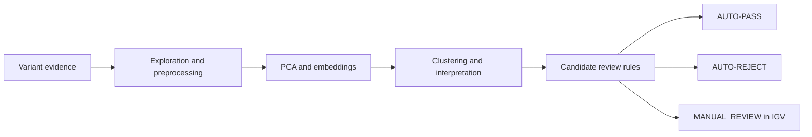
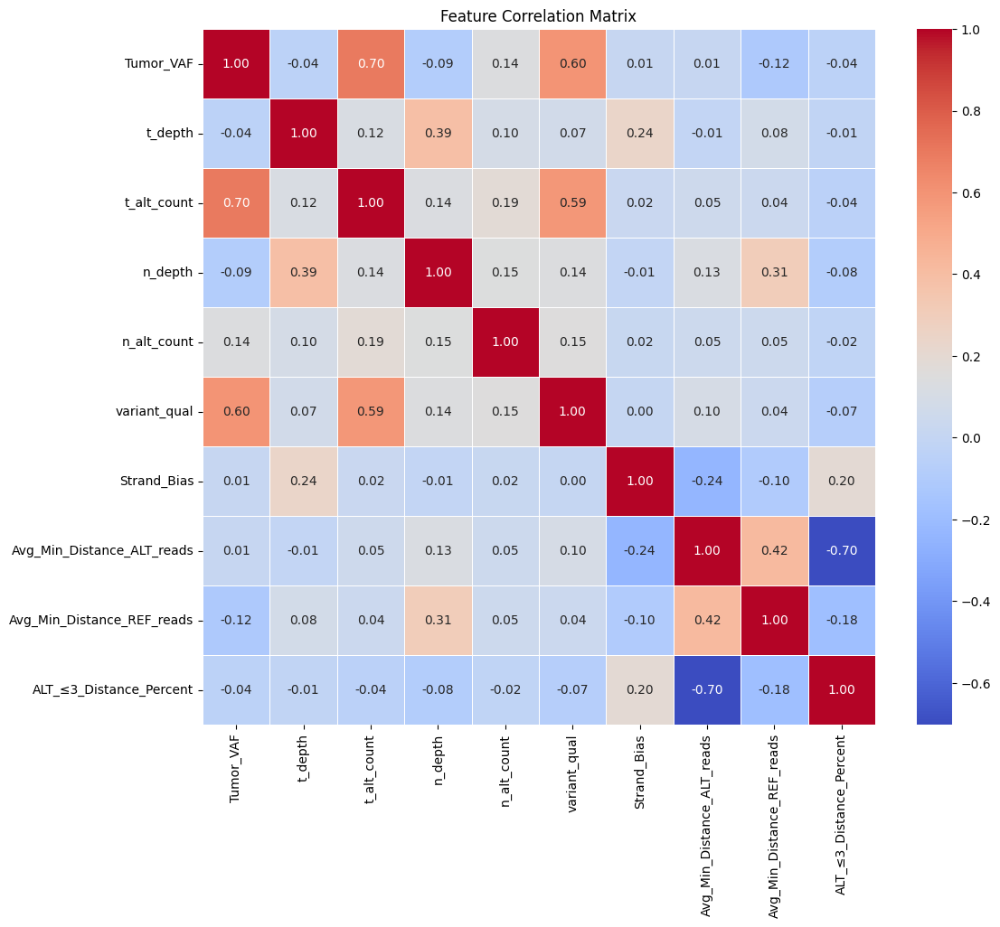

# False Positive Variants in Liquid Biopsy

**Exploring sequencing artifacts in cell-free DNA through statistical analysis, clustering, and interpretable review rules.**

[Analysis notebook](notebooks/variant_analysis.ipynb) · [Methods & findings](docs/methods-and-findings.md) · [Data guide](docs/data.md) · [Project presentation](https://docs.google.com/presentation/d/1VRVlxFJwOnT9711itlc5amiQRpV-2sJMkFSCQYh3cF0/edit)

## Why this project matters

Liquid biopsy can detect low-frequency variants in circulating cell-free DNA (cfDNA). At these low signal levels, sequencing artifacts can resemble real mutations. Even after laboratory-developed test (LDT) filtering, reviewing candidate variants in the Integrative Genomics Viewer (IGV) can require substantial manual work.

This student research project investigates whether variant quality, alternate-read support, and read-position metrics can help distinguish true-positive-like evidence from artifact-like evidence. The proposed outcome is a three-category review workflow: **AUTO-PASS**, **AUTO-REJECT**, and **MANUAL_REVIEW**.

**Status:** exploratory research prototype. These labels describe proposed workflow actions, not clinically validated decisions. The supplied materials do not establish sensitivity, precision, or measured time savings.

## What is included

- **Exploratory analysis:** missingness, feature distributions, outliers, and correlations across eight predefined variant groups.
- **Unsupervised learning:** standardization, PCA, UMAP, t-SNE, and K-Means comparisons with 4–6 clusters.
- **Interpretation:** exploratory `GOOD`/`BAD` cluster assignments and Mann–Whitney U comparisons of original-scale metrics.
- **Readable triage rules:** a Python module and command-line interface extracted from the final rule logic, with boundary tests and a synthetic example.



## Selected observations

The submitted notebook recorded **1,944 input rows** and retained **four principal components**, explaining approximately **96.3% of variance** in its processed feature space. These are historical outputs from the supplied analysis; the private source dataset is not distributed here.



*Original aggregate figure retained from the submitted notebook. Alternate-read support and variant quality are positively correlated; read-edge distance and the fraction of alternate evidence near read ends are negatively correlated. These associations motivate exploration but do not establish diagnostic performance.*

See [methods and findings](docs/methods-and-findings.md) for evidence, interpretation limits, and public-edition corrections.

## Run the public example

Python **3.12** is the reference environment. No clinical data or credentials are needed for the synthetic example.

```bash
git clone https://github.com/VictoriaMakaryan/False-Positive-Variants-in-Liquid-Biopsy.git
cd False-Positive-Variants-in-Liquid-Biopsy
python3 -m venv .venv
source .venv/bin/activate
python -m pip install -e '.[dev]'
python -m liquid_biopsy examples/synthetic_variants.csv --output /tmp/triaged_variants.csv
pytest
```

The example contains seven invented rows exercising threshold boundaries, pass-first precedence, and missing evidence. Its counts are a software demonstration, not research results. The CLI refuses to overwrite an existing output file.

### Candidate triage rules

Rules operate on **original, unscaled values**, in this order:

| Order | Condition | Proposed action |
| --- | --- | --- |
| 1 | `variant_qual > 380` **and** `t_alt_count > 31` | `AUTO-PASS` |
| 2 | Not already passed, and `Avg_Min_Distance_ALT_reads < 20` | `AUTO-REJECT` |
| 3 | Otherwise | `MANUAL_REVIEW` |

These thresholds reproduce the submitted notebook's executable rule, including strict inequalities and pass-first precedence. Missing evidence cannot satisfy a condition. They are candidate rules for investigation, not calibrated clinical cutoffs.

## Explore the notebook

```bash
python -m pip install -e '.[analysis,dev]'
jupyter lab
```

Open [`notebooks/variant_analysis.ipynb`](notebooks/variant_analysis.ipynb). To rerun the research analysis, provide an authorized local CSV matching the [data guide](docs/data.md), and set `LIQUID_BIOPSY_DATA` to its absolute path before launching Jupyter. The default is `data/private/All_groups_in_one.csv` in the checkout. No source dataset was supplied, so the real-data analysis cannot be reproduced from public files alone.

Embedded row-level outputs have been cleared. The notebook explains compatibility fixes, the corrected row join, and methodological limitations. Reusing historical cluster interpretations requires explicit opt-in.

For the exact tested dependency versions, install `requirements-lock.txt` before installing the local package with `python -m pip install --no-deps -e .`.

## Repository map

```text
notebooks/variant_analysis.ipynb   Curated research notebook
src/liquid_biopsy/                Extracted triage rules and CSV CLI
examples/synthetic_variants.csv   Invented inputs for a public demo
tests/                           Rule, CLI, and notebook checks
docs/                            Methods, data schema, and provenance
requirements-lock.txt            Tested Python 3.12 dependency snapshot
.github/workflows/checks.yml      Automated tests and notebook validation
```

## Team and provenance

This is a **team student project**. **Victoria Makaryan** maintains this repository. The [presentation's title slide](https://docs.google.com/presentation/d/1VRVlxFJwOnT9711itlc5amiQRpV-2sJMkFSCQYh3cF0/edit) identifies the project team and supervisors; this repository does not claim sole authorship of the team analysis. The supplied brief credits **Artem Galoyan** for project preparation and **Daniil Nikitin and Artem Galoyan** as supervisors.

The public edition organizes the supplied notebook, documents its methods, and extracts its final rule logic into tested code. See [provenance and changes](docs/provenance.md). Raw clinical data and the original document containing internal project context are not included. No redistribution license is asserted for team materials; contact the maintainers before reuse.
